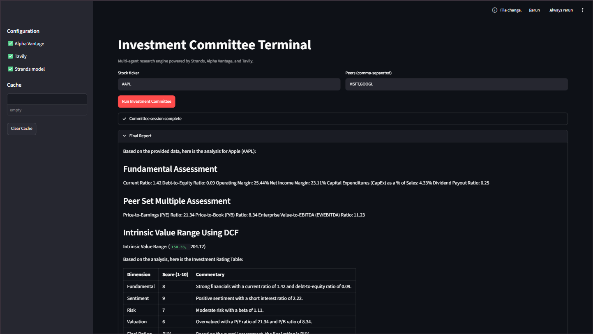

# Investment Agent App

Production-oriented, **SOLID** multi-agent investment research engine built with the [Strands Agents SDK](https://strandsagents.com/), a switchable market-data source (Yahoo Finance, Financial Modeling Prep, or Alpha Vantage), Tavily, and an in-memory TTL cache. The same orchestration core runs unchanged behind **Streamlit** (interactive streaming UI) or **FastAPI** (REST + SSE).

## Streamlit UI preview



The sidebar holds the research target (ticker and peers), API configuration status, and cache keys. The app has three pages:

| Page | What it does |
| --- | --- |
| **Dashboard** | Model-free research snapshot: KPI cards, rule-based "what stands out" flags, indexed price versus peers (6M / 1Y / 2Y), revenue / operating income / free cash flow, margin trend, earnings quality (net income versus free cash flow), bear/base/bull DCF against the market price, peer multiples with the peer median, and committee scores once the committee has run |
| **Committee** | Streams the five-specialist investment committee (fundamental, news and sentiment, risk, valuation, market) and the Managing Director's rating table and executive brief. Scores are parsed from the report and charted on the Dashboard |
| **Chat** | Follow-up questions grounded in the snapshot and the latest committee report, with tool access to statements, trends, DCF scenarios, peer multiples, price performance, and news |

## Architecture

| Layer | Responsibility |
| --- | --- |
| `src/providers/` | Vendor adapters (`IFinancialDataProvider`, `INewsDataProvider`) plus `CachedFinancialProvider`, which keeps vendor responses in the TTL cache to stay inside API rate limits |
| `src/domain/` | Plain dataclasses: `ResearchSnapshot`, `DcfResult`, committee scores, and rule-based insights |
| `src/tools/` | Financial math & Markdown formatters (depend on interfaces only) |
| `src/agents/` | Specialist personas, Managing Director orchestrator, and the research chat agent factory |
| `src/services/` | Framework-agnostic `InvestmentCommitteeService`, `ResearchService` (snapshot), and `ChatService` |
| `src/ui/` | Streamlit helpers: session state, charts, async-to-sync stream bridge |
| `app.py` / `app_pages/` / `api.py` | Delivery mechanisms (no business logic) |

### Chat history

Chat transcripts live behind the `IChatStore` interface (`src/services/chat_store.py`). The default `InMemoryChatStore` is process-local; the Streamlit app keeps one store per browser session, so a refresh clears the conversation and users never see each other's threads. A database-backed store can replace it by implementing `load`, `append`, and `clear`.

## Setup (uv — recommended)

Install [uv](https://docs.astral.sh/uv/getting-started/installation/) once, then from the repo root:

**Linux / macOS / WSL**

```bash
cd finsearch_ai
uv python pin 3.14          # optional; uses .python-version if present
uv sync --all-groups        # creates .venv, installs deps + dev tools, editable package
cp .env.example .env        # add API keys + STRANDS_MODEL
```

**Windows (PowerShell)**

```powershell
cd finsearch_ai
uv python pin 3.14
uv sync --all-groups
Copy-Item .env.example .env
```

You do **not** need `source .venv` / `Activate.ps1` for daily use — prefix commands with `uv run` (see below). To activate anyway: `.venv\Scripts\Activate.ps1` (Windows) or `source .venv/bin/activate` (Unix).

### After changing dependencies

```bash
uv add some-package          # add runtime dep (updates pyproject.toml + uv.lock)
uv add --dev ruff            # or use dependency-groups in pyproject.toml
uv lock                      # refresh lockfile only
uv sync --all-groups         # install from lock
```

### Required environment

- `TAVILY_API_KEY`
- `STRANDS_PROVIDER` — `bedrock` (default), `ollama`, or `groq`
- `STRANDS_MODEL` — Bedrock model id, an Ollama model name such as `llama3.1`, or a Groq model id such as `llama-3.3-70b-versatile`
- `OLLAMA_HOST` — Ollama server URL, used only when `STRANDS_PROVIDER=ollama` (default `http://127.0.0.1:11434`)
- `GROQ_API_KEY` — required when `STRANDS_PROVIDER=groq`
- `GROQ_BASE_URL` — Groq OpenAI-compatible endpoint (default `https://api.groq.com/openai/v1`)
- Provider credentials matching your model (AWS for Bedrock; Ollama needs the server running and the model pulled)

### Market data source

Choose the vendor with one line in `.env`, then restart the app (settings are read once at startup):

```env
FINANCIAL_DATA_PROVIDER=yfinance   # yfinance | fmp | alphavantage
```

| Value | Key needed | Notes |
| --- | --- | --- |
| `yfinance` (default) | none | Unofficial Yahoo Finance source. Roughly four annual statements. Coverage and availability can change without notice. |
| `fmp` | `FMP_API_KEY` | [Financial Modeling Prep](https://site.financialmodelingprep.com/) `/stable` API. Override the host with `FMP_BASE_URL`. Forward P/E is a paid FMP feature, so the dashboard shows trailing P/E instead. The free plan limits statement depth and symbol coverage. |
| `alphavantage` | `ALPHA_VANTAGE_API_KEY` | Strict free-tier rate limits. |

Every option implements the same `IFinancialDataProvider` interface and returns the same column names, so tools, agents, and the dashboard behave identically. The sidebar shows the active source. An unknown value stops startup with the list of allowed names.

To add a vendor, write one adapter that translates its payload with the helpers in `src/providers/schema.py` and register it in `src/providers/factory.py`.

## Run Streamlit UI

```bash
uv run streamlit run app.py
```

PowerShell: same command (`uv run` works on Windows).

Features: shared ticker and peers input, decision dashboard, live committee streaming with specialist tool status, per-session research chat, cache inspection and purge.

Vendors can rate limit requests (Alpha Vantage most strictly). The dashboard loads in sections; if a call is rate limited, that section shows as a data gap with a retry button and everything already loaded stays cached. Peers are capped at four.

## Run FastAPI

```bash
uv run uvicorn api:app --reload --port 8000
```

### Endpoints

- `POST /api/v1/evaluate` — synchronous JSON report (`metrics.scores` holds the parsed 1-10 scores and rating)
- `GET /api/v1/evaluate/stream?symbol=AAPL&peers=MSFT,GOOGL` — SSE token/tool events, ending with a `scores` event
- `GET /api/v1/snapshot?symbol=AAPL&peers=MSFT,GOOGL` — the research snapshot behind the dashboard (no model call)
- `POST /api/v1/chat` — stateless chat. Send `{"symbol", "peers", "messages": [{"role", "content"}], "committee_report"?}`; the last message must be from the user. The client owns the transcript until a database is added
- `DELETE /api/v1/cache` — purge TTL cache
- `GET /health` — liveness

## Extending providers (Open/Closed)

Implement `IFinancialDataProvider` or `INewsDataProvider` in `src/providers/` and wire the instance in `src/bootstrap.py`. Agents and tools remain untouched.

## Disclaimer

This project is for research and education. It is not investment advice.
